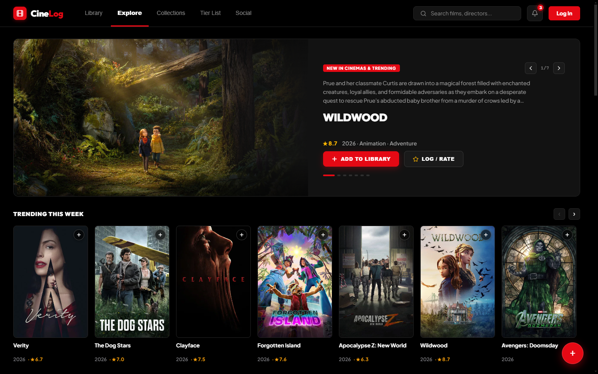

# 🎬 CineLog — Movie & TV Series Tracking Progressive Web App (PWA)

[](https://cinelog-phi.vercel.app)
[](https://react.dev)
[](https://www.themoviedb.org/)
[](https://cinelog-phi.vercel.app)

> **Live Application:** [https://cinelog-phi.vercel.app](https://cinelog-phi.vercel.app)  
> **Author:** Fábio Júnior Fernandes Silva — BSc in Web Multimedia Development @ IPCA (Portugal)



---

## 🌟 Overview & How It Works

**CineLog** is a mobile-first **Progressive Web App (PWA)** designed for discovering movies and TV series, curating personal watchlists, and logging structured review diaries. Built with **React**, **TypeScript**, and **The Movie Database (TMDB) REST API**, it delivers a dark-canvas tactile cinema interface optimized for both mobile touch viewports and desktop browsers.

### Key Capabilities
1. **Real-Time Cinema & Series Discovery**:
   - Queries live trending, top-rated, and upcoming movies/series via TMDB REST endpoints.
   - Instant debounced search with asynchronous poster caching and skeleton loading states.
2. **Personal Review Diary & Watchlist**:
   - Rate films, log viewing dates, write personal review notes, and organize custom collections.
   - Persistent client-side storage ensuring watchlists and ratings remain available offline.
3. **Touch-First Mobile PWA Ergonomics**:
   - Smooth bottom-sheet modal navigation, high-contrast typography, and responsive poster grids.
   - Installable on iOS, Android, and desktop via Web App Manifest.

---

## 🛠️ Tech Stack & Architecture

| Layer | Technology |
| :--- | :--- |
| **Frontend Framework** | React, TypeScript / ES6+ JavaScript |
| **Styling & UI** | Responsive CSS Grid/Flexbox, Custom Dark-Mode Tokens |
| **External Data API** | The Movie Database (TMDB) REST API |
| **State & Persistence** | React Hooks + Persistent LocalStorage Cache |
| **Hosting & CI/CD** | Vercel Edge Network (`cinelog-phi.vercel.app`) |

---

## 🚀 Getting Started Locally

```bash
git clone https://github.com/FabioSilva32/cinelog.git
cd cinelog
npm install
npm run dev
```


## Viewing and profile upgrades (preview)

This branch synchronizes the deployed redesign and adds episode progress, per-viewing diary editing, profile pins/connections, discovery filters, Undo and recoverable save states. Production remains on its reviewed release.

See [setup, validation and migration notes](FEATURE-UPGRADES-2026-11-23.md). Run `npm ci` and `npm run check:release`; create `.env.local` from `.env.example` for local API access. Never commit credentials. Browser account checks use isolated fixtures.
